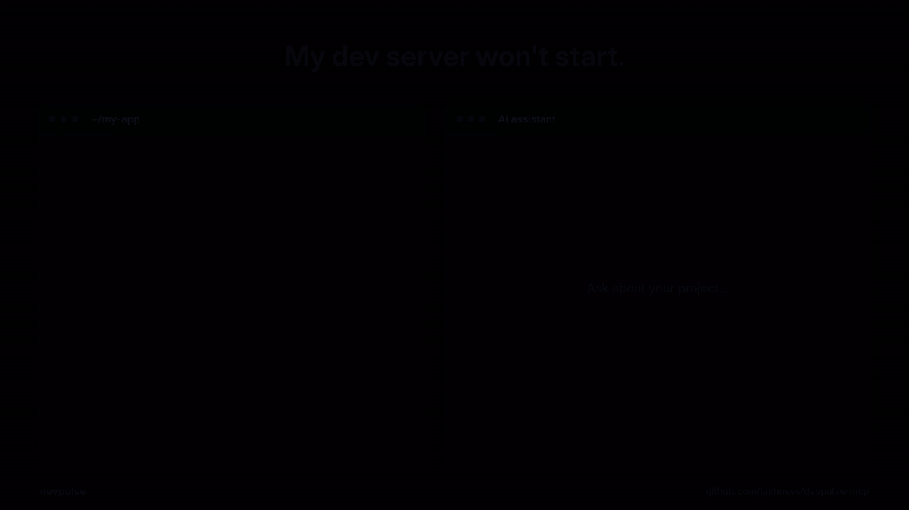

<div align="center">

<picture>
  <source media="(prefers-color-scheme: dark)" srcset="https://raw.githubusercontent.com/loxhness/devpulse-mcp/main/assets/logo-dark.png">
  
</picture>

### Your AI coding assistant can read your code. devpulse lets it see your dev environment.

[](https://www.npmjs.com/package/devpulse-mcp)
[](https://www.npmjs.com/package/devpulse-mcp)
[](https://github.com/loxhness/devpulse-mcp/actions/workflows/ci.yml)
[](https://registry.modelcontextprotocol.io/v0/servers?search=io.github.loxhness/devpulse-mcp)
[](https://nodejs.org)
[](LICENSE)

[](https://cursor.com/en/install-mcp?name=devpulse&config=eyJjb21tYW5kIjoibnB4IiwiYXJncyI6WyIteSIsImRldnB1bHNlLW1jcCJdfQ%3D%3D)&nbsp;
[](https://vscode.dev/redirect?url=vscode%3Amcp%2Finstall%3F%7B%22name%22%3A%22devpulse%22%2C%22type%22%3A%22stdio%22%2C%22command%22%3A%22npx%22%2C%22args%22%3A%5B%22-y%22%2C%22devpulse-mcp%22%5D%7D)&nbsp;
[](https://github.com/loxhness/devpulse-mcp/releases/latest/download/devpulse.mcpb)

<br>



</div>

<br>

## Why

Your assistant can't see your terminal. It doesn't know your dev server crashed, that another project is squatting on port 3000, or that you're halfway through a rebase with conflicts. So it asks you, and you copy and paste.

devpulse is an [MCP](https://modelcontextprotocol.io) server that answers all of that in **one tool call**, and returns a verdict with the likely cause and a suggested fix.

- **Finds port conflicts and names the culprit:** which process holds your port, its pid, and the folder it was started from.
- **Reads your logs:** recent errors with stack traces, repeat counts and timestamps, with secrets redacted.
- **Checks the rest of your setup:** git state, merge conflicts, missing dependencies and runtime versions.
- **Zero config:** no API key, no account, nothing to set up. Runs locally on Linux, macOS and Windows.

## Quick start

| Client | Install |
| --- | --- |
| **Claude Code** | `/plugin install devpulse --marketplace loxhness/devpulse-mcp` (adds a `/devpulse:diagnose` skill)<br>or `claude mcp add devpulse -- npx -y devpulse-mcp` |
| **Cursor** | [One-click install](https://cursor.com/en/install-mcp?name=devpulse&config=eyJjb21tYW5kIjoibnB4IiwiYXJncyI6WyIteSIsImRldnB1bHNlLW1jcCJdfQ%3D%3D) |
| **VS Code** | [One-click install](https://vscode.dev/redirect?url=vscode%3Amcp%2Finstall%3F%7B%22name%22%3A%22devpulse%22%2C%22type%22%3A%22stdio%22%2C%22command%22%3A%22npx%22%2C%22args%22%3A%5B%22-y%22%2C%22devpulse-mcp%22%5D%7D) |
| **Claude Desktop** | Download [devpulse.mcpb](https://github.com/loxhness/devpulse-mcp/releases/latest/download/devpulse.mcpb) and double-click it, then pick a default project folder in its settings |
| **Anything else** (Windsurf, Cline, Zed, ...) | Add the config below |

```json
{
  "mcpServers": {
    "devpulse": {
      "command": "npx",
      "args": ["-y", "devpulse-mcp"]
    }
  }
}
```

Requires Node 18 or later. Then ask your assistant what's wrong; it calls devpulse on its own.

## What your assistant sees

Real output for a Next.js project whose dev server won't start:

```json
{
  "diagnosis": {
    "health": "broken",
    "primary_issue": "Port conflict: another process is using this project's dev server port",
    "secondary_signals": ["Port 3000 is held by node (pid 1576), started from /home/you/old-app"],
    "suggested_action": "Stop the other process (it belongs to a different directory) or run this dev server on a different port",
    "confidence": "high"
  },
  "session": {
    "project": "my-app",
    "framework": "nextjs",
    "git": { "branch": "feat/auth", "uncommitted_files": 5, "conflicted_files": 0, "last_commit_message": "Add login form" }
  },
  "services": {
    "running": [{ "port": 3000, "pid": 1576, "name": "node", "process_cwd": "/home/you/old-app", "owned_by_project": false }]
  },
  "recent_errors": [
    {
      "time": "2m ago",
      "level": "ERROR",
      "message": "Error: listen EADDRINUSE: address already in use :::3000",
      "stack": ["at Server.setupListenHandle [as _listen2] (node:net:1872:16)"],
      "source": "logs/dev.log",
      "count": 1
    }
  ],
  "env": { "node": "22.11.0", "package_manager": "pnpm" }
}
```

<sub>Shortened. The full snapshot also includes process start times, ports that couldn't be checked, ahead/behind counts, runtime versions and the log files scanned.</sub>

## What it diagnoses

| Problem | How devpulse knows |
| --- | --- |
| **Port conflict** | A recent `EADDRINUSE`, or the dev port held by a process started from a different folder |
| **Old instance still running** | The process on the port belongs to this project and started before the error |
| **Dev server crashed** | Nothing on the expected port, and errors in the last hour of logs |
| **Dev server not started** | Nothing on the expected port, and no errors |
| **Failed to start, port free now** | `EADDRINUSE` was logged, but the port has since been released |
| **Merge conflicts** | Conflicted files, or a merge or rebase in progress |
| **Dependencies not installed** | `package.json` has dependencies but there's no `node_modules` |
| **Runtime mismatch** | Installed Node or Python differs from `.nvmrc`, `.node-version`, `engines` or `.python-version` |
| **Errors while running** | The server is up, but errors were logged |

## Tools

| Tool | Use it for |
| --- | --- |
| `get_session_snapshot` | Everything above in one call. Assistants call this first. |
| `get_recent_errors` | More than the snapshot's 10 newest errors, with full stack traces (`limit` 1 to 200) |
| `get_running_services` | Re-checking ports after a restart, without the full snapshot |

All three are read-only and take an optional `cwd`.

## Supported projects

| Language | Detected from | Frameworks |
| --- | --- | --- |
| JavaScript / TypeScript | `package.json` | Next.js, Nuxt, SvelteKit, Astro, Remix, Angular, Vite, NestJS, Fastify, Express, Create React App |
| Python | `pyproject.toml`, `requirements.txt`, `Pipfile`, `manage.py` | FastAPI, Django, Flask |
| .NET | `*.csproj`, `*.sln` | ASP.NET Core (ports from `Properties/launchSettings.json`) |
| Go, Rust | `go.mod`, `Cargo.toml` | Any |

Ports come from your own config when devpulse can find them (`--port`, `-p` or `PORT=` in your dev script, `PORT` in `.env`, `server.port` in `vite.config`, `launchSettings.json`), and from framework defaults otherwise.

<details>
<summary><b>Which project does it look at?</b></summary>

<br>

1. The `cwd` the assistant passes, if any
2. The workspace folder your editor reports over MCP (roots)
3. `DEVPULSE_PROJECT_DIR`, if set (the Claude Desktop extension sets this from its settings)
4. The folder the server was launched from (Claude Code launches it in your project)

</details>

<details>
<summary><b>Limitations</b></summary>

<br>

- **Errors come from log files.** Most dev servers print to the terminal instead of a log file, so if your project has no `.log` files, `recent_errors` will be empty. Port, git and dependency checks still work. Terminal capture is planned for 0.2.
- **Ownership and start times aren't checked on Windows.** Ports and processes are still detected, but devpulse can't tell whose process it is, so it reports conflicts at lower confidence.
- **Runtime versions** are read from the environment devpulse runs in, which can differ from your shell if you use nvm or pyenv. Mismatches are reported as signals, not verdicts.

</details>

## Privacy and security

- Runs entirely on your machine and makes no network requests.
- Read-only: devpulse never changes files, stops processes or runs your code.
- Secrets (API keys, tokens, passwords and credentials in URLs) are redacted from log lines before your assistant sees them.
- Every npm release is built and published from GitHub Actions with [provenance](https://docs.npmjs.com/generating-provenance-statements).

## Development

```bash
npm install
npm test          # unit tests plus end-to-end tests over stdio
npm run build
```

CI runs on Linux, macOS and Windows with Node 18, 20 and 22. To release, run `npm version patch && git push --follow-tags`: the release workflow tests, publishes to npm and the MCP Registry, builds the Claude Desktop extension and creates the GitHub release from [CHANGELOG.md](CHANGELOG.md).

Bug reports and ideas are welcome in [Issues](https://github.com/loxhness/devpulse-mcp/issues).

## License

[MIT](LICENSE) © Uzair Suboor
